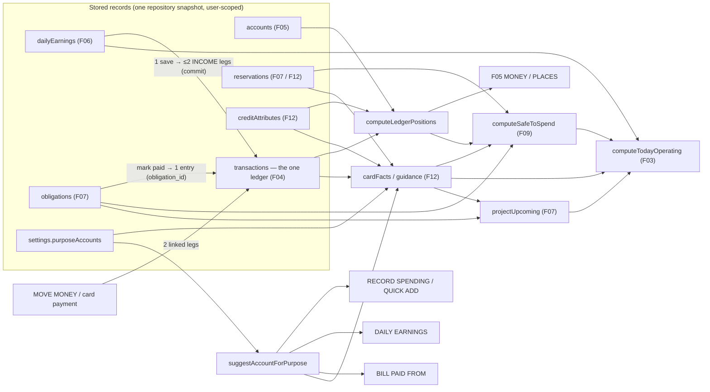

# 13 · Cross-family dependency and data flow

| Event | Writes (one commit) | Visible in |
| --- | --- | --- |
| Save daily earnings | dailyEarnings + 1–2 INCOME entries | F06 totals, F05 balances, F04 rows, F09 cash, F12 "free for this card", F03 earned / next steps |
| Edit / remove a day | same record + same legs rewritten / removed | same, by the difference |
| Record spending | 1 EXPENSE or CREDIT_PURCHASE entry | F04, F05, F12 (card owed), F09 (cash only for EXPENSE) |
| Move money | 2 TRANSFER legs | F05 both accounts; F04 two rows labelled TRANSFER; F09 unchanged unless an account is excluded |
| Card payment | 2 CREDIT_PAYMENT legs | F12 owed / minimum remaining, F05 source, F09 card minimums + cash |
| Add / edit bill | obligation | F07, F09 bills due, F03 slip + coming |
| Set money aside | reservation (no ledger entry) | F07 funding line, F09 "set aside inside", F03, F12 source plan |
| Mark paid | 1 entry + obligation advanced + reservations settled | F07, F04, F05, F09, F03 |
| Balance correction | 1 ADJUSTMENT entry (or entered balance if no entries yet) | F05, F09 |

No family keeps a copy of another family's figure. Every summary is a read of these records at render time (`useRepoTick` / `useSyncExternalStore` on the repository), so one change updates every view on the next render and on reload.
