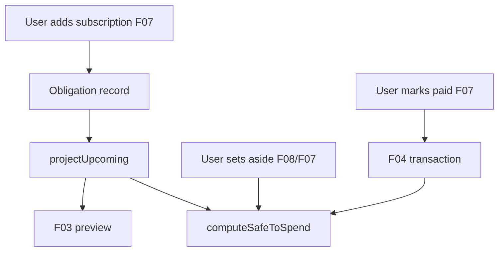

# JURNL cross-family financial coordination map

## Authoritative owners

| Domain | Owner | Storage |
| --- | --- | --- |
| Subscriptions / bills | F07 | `JurnlObligation` |
| Income | F06 | `JurnlIncomeSource` |
| Plan assign | F08 | `JurnlPlanIntention` |
| Goals set-aside | F14 | `JurnlGoal` |
| Purchases / trips reserve | F10 / F11 | entity records |
| Ledger | F04 | `LedgerEntry` via repository |
| Safe to Spend | F09 | **derived** `computeSafeToSpend` |
| TODAY summary | F03 | **derived** from money helpers |
| Credit payments upcoming | F12 | projected into F07 |

## Flow (target)

## Current gaps

- **No** `pay → ledger` edge for obligations
- **No** `fund → obligation` edge (plan assign orphan)
- STS reads obligations **once** on snapshot; subscribe via repository ✅

## Update propagation

| Event | Propagates? |
| --- | --- |
| CREATE obligation | Upcoming + STS ✅ |
| EDIT amount | ✅ |
| RESERVE (trip) | STS ✅ (E2E flaky) |
| RESERVE (bill) | ❌ |
| PAY bill | ❌ |

**Classification:** PARTIAL — single repo, good projections; **missing pay/fund links**.
